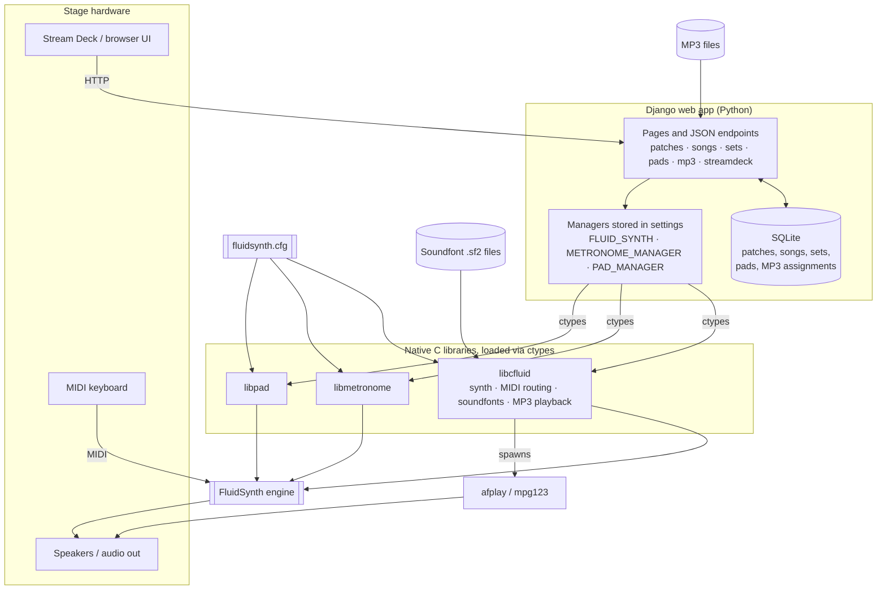

# Architecture Overview

## How it fits together

- **Control:** The Stream Deck or browser sends HTTP requests to Django. Activating a song or set looks up its patch in SQLite and applies it to the synth.
- **Bridge:** Django starts three managers at launch and stores them in settings. Each manager wraps a native C library through `ctypes`.
- **Audio:** FluidSynth turns the keyboard's MIDI input into sound using the loaded soundfonts. The metronome and pad libraries drive the same engine. MP3s play as a separate `afplay`/`mpg123` process.
- **Configuration:** All three C libraries read the same `fluidsynth.cfg`.
